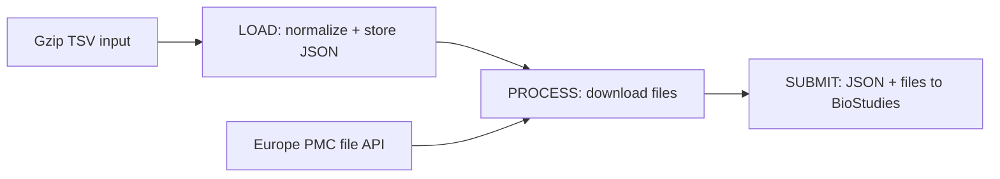

# PMC processor task

Imports Europe PMC submissions into BioStudies. Each invocation runs one stage selected by `app.data.mode`:
`LOAD`, `PROCESS`, or `SUBMIT`. Run them in order, using the same MongoDB database and temporary storage.

## Stages

### LOAD — import and normalize

Reads the UTF-8, gzip-compressed TSV PageTab input at `app.data.loadFolder`. LOAD reads the folder's `.gz` files, or one
archive selected by `loadFile` relative to that folder. Archive names follow `bs-DD-MM-YYYY-<sequence>.txt.gz`,
e.g. `bs-07-02-2024-6.txt.gz`. The date and sequence identify the source order.

The loader separates submissions at `Submission` rows and performs these transformations **before deserialization**:

- Removes padding tabs around line breaks.
- Adds or replaces the submission's required `ReleaseDate` with January 1 of the publication year. The input must contain
  a `Publication` section with a `Publication date` containing a four-digit year; `2020 May` becomes `2020-01-01`. This
  value comes from the EuropePMC database for which they use different publication dates including Medline article date,
  print pub date, journal publication date and derive article first publication date.
- Replaces link attribute values exactly equal to `gen` with `ENA`, in individual links and link tables. Link URLs and
  attribute details are preserved.

Stores normalized JSON as `LOADED` in the `pmc_submissions` mongo collection, with the archive's absolute path and 
zero-based submission position. Newer source versions supersede older records for the same accession, marking them 
`DISCARDED`.

Processed `.gz` files are moved to a folder named `processed` in the input folder.

### PROCESS — download referenced files

Claims `LOADED` records as `PROCESSING` and downloads referenced files from
`<pmcBaseUrl>/files/getFileStream/PMC<id>?filename=<file-path>`, deriving the ID from the `S-EPMC` accession.
Downloads have up to three attempts; existing local files are reused. Successful records become `PROCESSED`
with file references, preserving the normalized submission body.

### SUBMIT — upload to BioStudies

Claims `PROCESSED` and `ERROR_SUBMIT` records as `SUBMITTING`. Uploads stored JSON and downloaded files through the
BioStudies asynchronous multipart API, using NFS storage, silent mode, and single-job mode (default batch size: 200).
API acceptance sets `SUBMITTED` and records the returned version; BioStudies completes the asynchronous submission work.

## Data locations

| Location | Contents |
| --- | --- |
| `<loadFolder>/*.gz` | Incoming PageTab archives. |
| `<loadFolder>/processed/<archive>` | Inspected archives, including those with individual submission errors. |
| `<loadFolder>/failed/<archive>` | Archives that could not be read or decompressed. |
| `<temp>/<last-3-accession-characters>/<accession>/<sourceTime>/<position>/<file-path>` | Downloaded files used by SUBMIT. `sourceTime` is the archive date and sequence joined as `YYYYMMDD<sequence>`. |
| MongoDB `pmc_submissions` | Normalized JSON, source information, status, file references, and submitted version. |
| MongoDB `pmc_submissions_files` | Downloaded file names and absolute paths. |
| MongoDB `pmc_input_files` / `pmc_errors` | Archive outcomes / submission errors, stage, input body, and stack trace. |

For `bs-07-02-2024-6.txt.gz`, accession `S-EPMC1234567`, and the first submission, a downloaded file is stored at
`<temp>/567/S-EPMC1234567/202402076/0/file1.txt`.

## Configuration and recovery

Configure `app.data.*` properties in [application.yml](src/main/resources/application.yml): input and temporary paths,
MongoDB connection/database, PMC API URL, BioStudies URL/credentials, and notification URL.

Optional controls are `loadFile` for LOAD, `sourceFile` for PROCESS/SUBMIT (the exact stored archive path), and `limit` 
and `batchSize` for SUBMIT. `SUBMIT_SINGLE` submits one record selected by `submissionId`, its MongoDB document ID.

Invalid submissions during LOAD go to `pmc_errors`; the archive continues. PROCESS/SUBMIT failures set `ERROR_PROCESS` /
`ERROR_SUBMIT`. SUBMIT retries its errors on the next run; PROCESS selects only `LOADED`, so its failures require
investigation and a deliberate reset before retrying.

The [pipeline integration test](src/test/kotlin/ac/uk/ebi/pmc/itest/PmcPipelineIntegrationTest.kt) covers all three stages,
normalization, downloads, multipart uploads, and the returned version.
